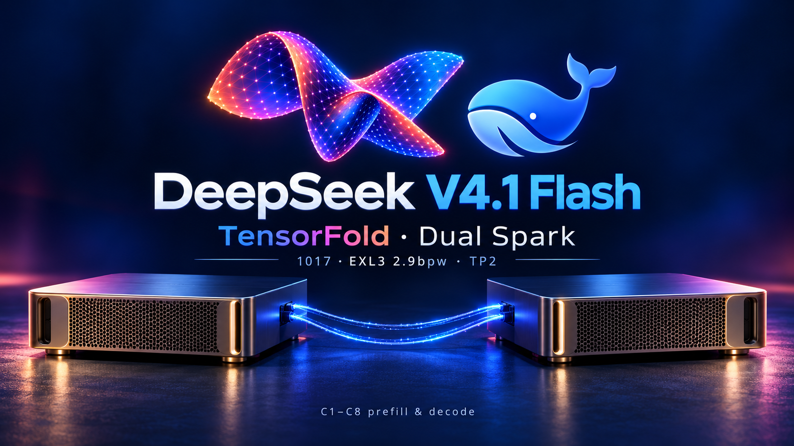

# DeepSeek V4.1 Flash 1017 Dual Spark



A pinned deployment recipe for [`LibertAIDAI/DeepSeek-V4.1-Flash-1017-EXL3-2.9bpw`](https://huggingface.co/LibertAIDAI/DeepSeek-V4.1-Flash-1017-EXL3-2.9bpw) across two DGX Spark / GB10 systems. It provides separate TensorFold and vLLM profiles using the same checkpoint and official 1017 Engram tables, plus a reproducible C1–C8 prefill and decode benchmark with thinking disabled and thinking effort 75.

The tested TensorFold path is its Python 0.6.0 engine with Jay Leaton's DeepSeek family patches and the small 1017 adaptations in this repository. The upstream Zig engine and 2.8bpw pack are separate deployment paths. Results here identify the engine, weights, thinking mode and measurement conditions explicitly.

## Dashboard benchmarks: 2026-10-18

Tuned TensorFold on two GB10 systems. Thinking off, temperature zero; code, prose,
structured output and prefill each ran separately, with two isolated passes.

| Generation, aggregate output tok/s | C1 | C2 | C4 | C8 |
| --- | ---: | ---: | ---: | ---: |
| Code | 103.4 | 149.7 | 193.3 | 267.0 |
| Prose | 59.1 | 85.0 | 110.1 | 139.1 |
| Structured (counting) | 91.0 | 131.6 | 127.4 | 166.5 |

Medians use the dashboard’s first-to-last streaming window and a **400-token output
cap**. C2–C8 can include interleaved prefill. Code C2 ranged 127.2–172.1 tok/s.
Structured counting produced 50–400 tokens per request, without schema enforcement.

**Separate cold-prefill runs, C1 and one output token:**

| Dashboard target | Actual input tokens | Median TTFT (s) | Input tok/s |
| ---: | ---: | ---: | ---: |
| ~1,024 | 1,130–1,131 | 2.38 | 475.7 |
| ~4,096 | 4,552–4,553 | 7.30 | 623.7 |
| ~16,384 | 18,211 | 21.15 | 861.0 |
| ~65,536 | 72,811–72,814 | 78.38 | 929.0 |

Input throughput includes scheduling and first-token delivery. Prompt reuse was
disabled and cache-hit deltas were zero. All **104 requests** matched server
counters. [Raw records and ranges](results/dashboard-20261018/summary.json) and
[Protocol and reproduction](docs/benchmark-method.md#dashboard-workloads-on-2026-10-18).
These workload rates use a different window from the tuning comparison below.

<a id="update-2026-10-18"></a>

<details>
<summary>Exact tuning comparison: 2026-10-18</summary>

The current exact TensorFold profile expands graph coverage and expert-pass
capacity using the same checkpoint, Engrams, precision and existing kernels.
Against a fresh matched TensorFold baseline:

| C8 metric, aggregate tok/s | Original | Tuned | Change |
| --- | ---: | ---: | ---: |
| Decode only, thinking off | 122.1 | 125.4 | +2.7% |
| Decode only, effort 75 | 204.2 | **238.2** | **+16.6%** |
| End to end, thinking off | 78.4 | 80.3 | +2.4% |
| End to end, effort 75 | 104.6 | **112.5** | **+7.5%** |

Cold prefill improved **2.4–6.9%** across 1,536/3,072-token prompts; C1 decode
remained within 1.5%. All **44 timed requests and 2,312 output tokens per profile**
retained identical native prompt IDs, full output token IDs and text. These are
medians of two repeats from one boot per profile: 128-input/64-output-token prose
decode, with separate cap-one cold-prefill tests. Decode uses a verified interval
after all requests start emitting; end-to-end rates include prefill and complete
batch response delivery. No sustained-throughput or broad quality claim is made.
[Comparison and raw records](results/exact-tuning-20261018/comparison.json),
[measurement scope and reproduction](docs/benchmark-method.md#exact-tuning-on-2026-10-18)
and [retained settings](config/tensorfold-knobs.env.example).

</details>

<details>
<summary id="original-cross-engine-measurements">Original TensorFold and vLLM comparison</summary>

The original cross-engine comparison below uses a different ledger workload and
streaming window. Its C8 rates must not be compared directly with the new
decode-only suffix measurements. vLLM was not rerun for the tuning comparison.

**TensorFold is faster for single-request decode. vLLM is faster for effective prefill in these quick runs.**

Both engines completed **144 requests each** across C1–C8, thinking disabled and reasoning effort 75, with separate prefill and decode runs. Prompt hashes and input/output token counts match across engines. [Full comparison and raw records](results/README.md).

Decode is **single-request C1 output tok/s**, measured after the first token and excluding initial prefill. Prefill is the **best measured effective input tok/s** from C1–C8; its concurrency is shown beside the rate. Prefill includes scheduling and first-token delivery.

| Engine | Thinking | Raw decode (tok/s, C1) | Best prefill (input tok/s) |
| --- | --- | ---: | ---: |
| TensorFold | off | 58.1 | 451.2 (C2) |
| TensorFold | 75 | **77.5** | 444.0 (C7) |
| vLLM | off | 36.9 | 850.8 (C6) |
| vLLM | 75 | 41.4 | 840.5 (C6) |

TensorFold leads single-request decode in both thinking modes. vLLM leads effective prefill. These are the best observed prefill rates from one short pass, not sustained-throughput estimates. [Full C1–C8 measurements and raw records](results/README.md) retain the complete comparison.

These are short, single-pass endpoint measurements, not a quality evaluation or an estimate of sustained long-response performance. Both engines use the same checkpoint. See [the method](docs/benchmark-method.md) for decode-window rates, per-stream timing and limitations. Decode tests cap output at 64 tokens; separate prefill tests cap it at one token.

</details>

## Hardware and storage

- Two GB10 systems with 128 GB unified memory each, Linux arm64, NVIDIA Container Toolkit and Docker.
- Passwordless SSH from head to worker, with host keys already trusted.
- A direct fabric link with working RoCE. The measured configuration enabled both available fabric links.
- Approximately 196 GiB for EXL3 weights, 189 GiB for the official Engram source tables and 94.4 GiB for rank 0's packed Engrams on the head, plus container images and caches.
- Approximately 94.4 GiB of packed Engrams on the worker, plus images and compiled caches. The worker reads the checkpoint over a read-only NFS export on the fabric. TensorFold prepared-cache writes are disabled for this storage layout.

Keep Engram lookup local to each rank. The checkpoint and Engram source revisions are pinned in [config/manifest.json](config/manifest.json). The two large Engram tables are from **DeepSeek-V4.1-Flash-1017**, matched to this checkpoint.

## Prepare the sources and image

```bash
bash scripts/fetch-sources.sh
docker build -t deepseek41-tensorfold:1017 .
docker save deepseek41-tensorfold:1017 | ssh spark-b docker load
```

The Dockerfile uses NVIDIA PyTorch 26.07, preserves its torch and Triton versions, and installs the tested TensorFold source export. The source script applies upstream patches before the local 1017 patch. It leaves the original source checkouts available for review.

Set `TF_DSV41_BIAS_VL=/model` on both ranks: this 1017 checkpoint contains the image-router biases inline. The preflight reads all 43 bias tensors and checks that the native attachment path loads the 40 main-layer routers correctly.

The local adaptations cover 1017's inline image-router biases, 6-bit dense MTP layers in the vLLM overlay, tool-only turn handling, the actual TensorFold shared-pool memory budget, revision-specific packed paths and repeatable metadata publication to the NFS share.

## Download and verify the assets

```bash
python3 -m venv .venv
. .venv/bin/activate
pip install huggingface_hub==2.2.0 hf-xet==1.7.0
python scripts/download.py --root /srv/models/deepseek-v41-1017
```

The downloader verifies Hub LFS SHA-256 checksums, records a manifest and supplies the reference-tested chat template. The checkpoint does not supply a Hugging Face chat-template file; the TensorFold HTTP app needs one during initialization, even though its native encoder renders actual DeepSeek prompts.

## Publish weights and pack Engrams

Configure `build/mia-runtime/.env` using the [deployment example](docs/deployment.md) and the tuning values in [config/vllm-knobs.env.example](config/vllm-knobs.env.example). Set the new bundle paths and `EXPECTED_SHARDS=43`, then run:

```bash
bash build/mia-runtime/start.sh prepare
bash build/mia-runtime/start.sh pack
```

`prepare` publishes the source files and writes launch scripts without starting GPU servers. `pack` creates `engram-l1-r0of2.bin` and `engram-l14-r0of2.bin` on the head, and the rank 1 equivalents on the worker. Use unique directories for this model revision. Each file uses the same hash-head partitioning expected by both runtimes.

Check the packs with the upstream TensorFold checker; it compares headers, sizes and sampled records with the verified source:

```bash
python build/jayleaton/scripts/pack_engram.py \
  --src /srv/models/deepseek-v41-1017/engram-src-1017 \
  --config /srv/models/deepseek-v41-1017/checkpoint/config.json \
  --check /srv/deepseek-v41/engram-packed-1017 --rank 0
```

Run the rank 1 check on the worker with its source NFS volume mounted read-only. Both packs were checked with both runtimes' readers during deployment.

## Compile and start TensorFold

Copy [config/cluster.env.example](config/cluster.env.example) to `config/cluster.env` and set the real host, fabric and storage values. The worker model setting accepts a Docker NFS volume name. Algorithm settings are in [config/tensorfold-knobs.env.example](config/tensorfold-knobs.env.example).

[The deployment guide](docs/deployment.md) includes CPU-only extension precompilation and copying the compiled cache to the second identical GB10 system. Precompile before loading the model so compilation does not compete with the resident weights for memory.

```bash
python scripts/cluster.py check
python scripts/cluster.py args
python scripts/cluster.py start
python scripts/cluster.py health
```

The launcher uses the same container name on both nodes, starts rank 1 before rank 0 and affects only those containers. It refuses startup while another GPU workload is running. Stop the existing inference service explicitly before switching engines. Initial weight loading and graph warmup take several minutes.

To stop this profile:

```bash
python scripts/cluster.py stop
```

For vLLM, the patched Mia kit provides `bash build/mia-runtime/start.sh start`. Apply the pinned image digest and tuning file first. [Dashboard integration](docs/dashboard-integration.md) describes the two-selector layout used on port 11001.

## Benchmark

Run one engine at a time with other API clients paused:

```bash
python scripts/benchmark.py \
  --model deepseek-v4.1-flash-1017-tensorfold --label tensorfold \
  --thinking off --input-lines 27 --output-tokens 64 --repeats 1 --skip-warmup --out results/raw-local/tensorfold-off

python scripts/benchmark.py \
  --model deepseek-v4.1-flash-1017-tensorfold --label tensorfold \
  --thinking 75 --input-lines 27 --output-tokens 64 --repeats 1 --skip-warmup --out results/raw-local/tensorfold-thinking75
```

Use the vLLM model ID `deepseek-v4.1-flash-1017-exl3` with the same arguments after switching. For prefill-only tests, add `--output-tokens 1`. The complete matrix, token lengths, counting conventions and limitations are documented in [the method](docs/benchmark-method.md).

## Scope and attribution

This repository distributes the integration recipe, source patches and benchmark artifacts. Model weights and private machine configuration are downloaded or supplied separately. Upstream components retain their existing licenses, included in `LICENSES/`; no blanket license is added for original integration material.

## Credits

- [Anemll dual-Spark dashboard](https://github.com/anemll/dspark-vllm-gx10) and [MiaAI sparkDash](https://github.com/MiaAI-Lab/sparkDash): the port-11001 dashboard prompts and benchmark protocol, used through the installed dashboard module.
- [Jay Leaton's DeepSeek V4.1 TensorFold Spark recipe](https://github.com/jayleaton/deepseek-v41-tensorfold-spark): the DeepSeek TensorFold engine patches, packing format, tuning and deployment work.
- [TensorFold](https://github.com/ashhart/TensorFold): the Python inference runtime, CUDA kernels and TensorFold brand mark.
- [MiaAI's DeepSeek V4.1 EXL3 dual-Spark kit](https://github.com/MiaAI-Lab/DeepSeek-v4.1-Flash-EXL3-2x-DGX-Sparks): the vLLM runtime, file-backed Engram implementation, packing tools, chat template and sharing helpers.
- [LibertAIDAI's EXL3 checkpoint](https://huggingface.co/LibertAIDAI/DeepSeek-V4.1-Flash-1017-EXL3-2.9bpw) and [DeepSeek's official 1017 model](https://huggingface.co/deepseek-ai/DeepSeek-V4.1-Flash-1017): model weights, tokenizer, reference encoder and matching Engram tables.
- [npaka's TensorFold overview](https://note.com/npaka/n/n3d3e09549bdd): the supplied artwork reference. The TensorFold logo reference came from the upstream asset; TensorFold and DeepSeek marks belong to their respective owners. [Artwork prompt](assets/artwork-prompt.txt).
